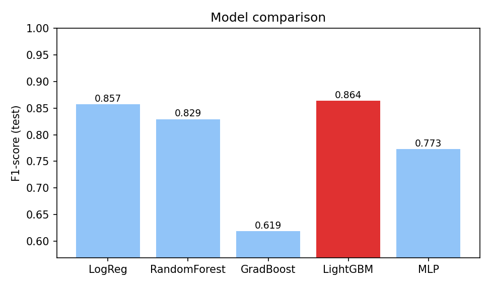
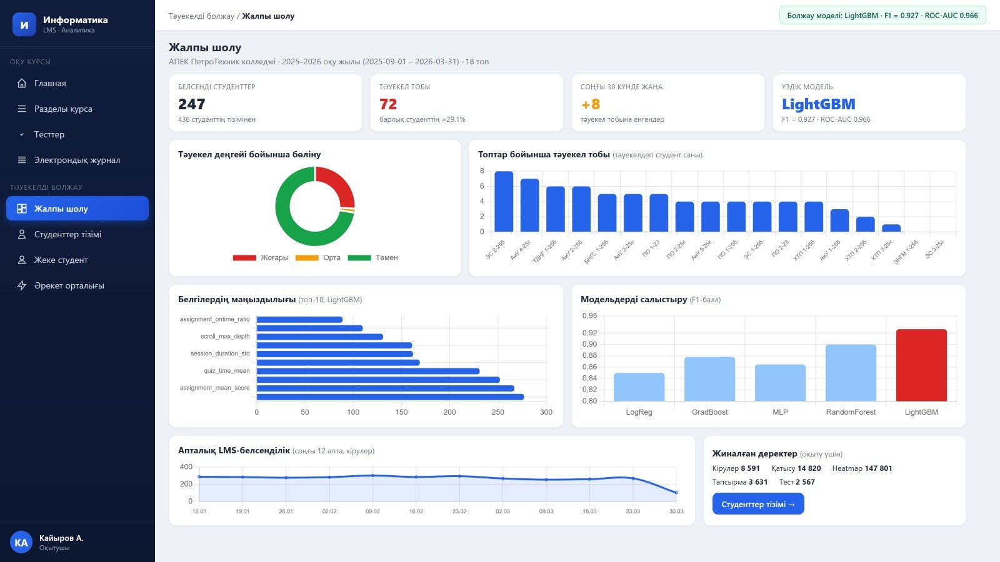
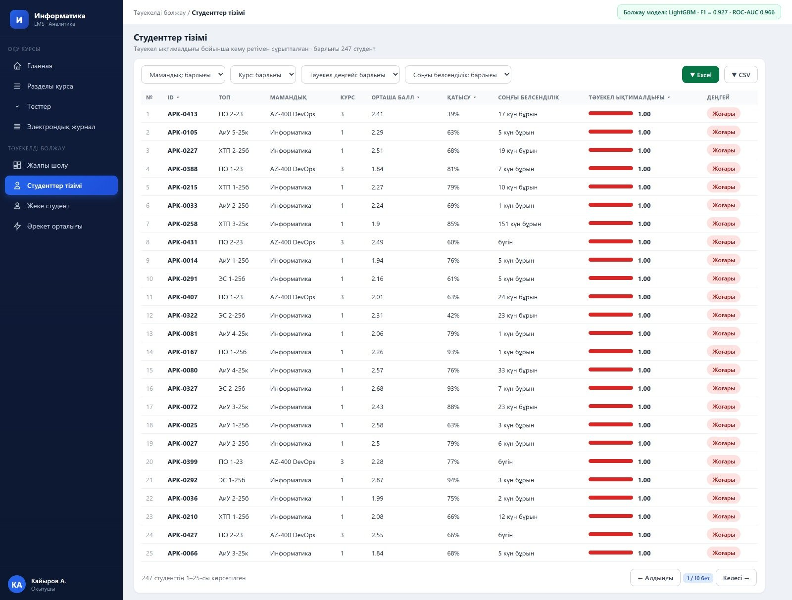
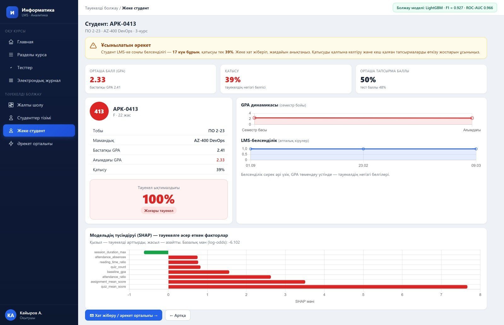
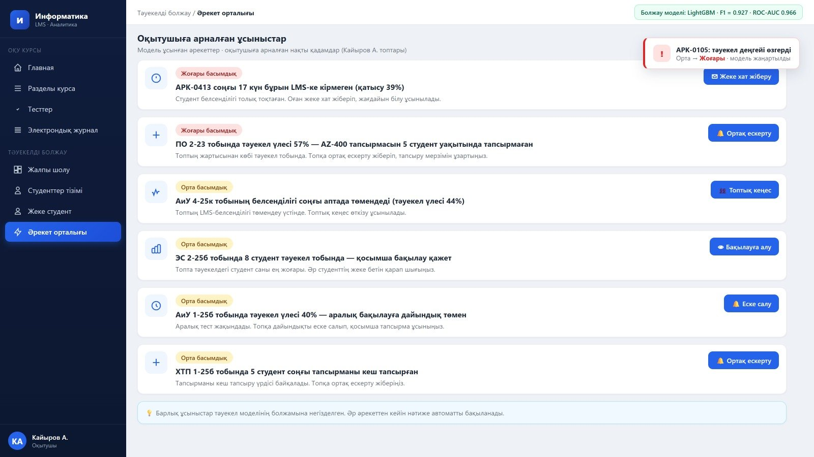

# LMS Student Risk Prediction

Machine-learning pipeline that predicts which students are at academic risk from their activity in a
Learning Management System (LMS): clickstream events, assignments, quizzes and attendance.
It includes data generation, model training and comparison, and a **FastAPI** prediction microservice
with per-student explanations.

> Based on the author's Master's thesis *"Using Machine Learning Methods to Predict User Actions in Mobile
> Applications"* (Atyrau University named after Kh. Dosmukhamedov, 2026), applied to students' activity in a
> college LMS. 🇷🇺 [Русская версия](README.ru.md)

## ⚠️ About this repository

- The **original source code was lost**. This repository is a clean **re-implementation** of the methodology
  described in the thesis (same 22-feature design, same five algorithms and hyper-parameters, same API design).
- The real LMS data contains personal data of students and **is not published**. The pipeline runs on a
  **synthetic dataset** (`generate_dataset.py`) with the same structure: 247 students, 18 groups, ~29% at risk.
- Therefore the metrics below come from synthetic data and are **not** the thesis results.
  Thesis results on real data: LightGBM F1 = 0.927, ROC-AUC = 0.966, Accuracy = 0.960.
- Screenshots in `docs/screenshots/` show the original Vue.js analytics dashboard from the thesis
  (student identifiers are anonymised). The dashboard code is not part of this repository.

## Pipeline

```
generate_dataset.py  ->  data/students.csv   (22 features + at_risk label)
train_model.py       ->  models/lightgbm_risk.joblib + reports/ (metrics, plots)
prediction_api.py    ->  REST API (FastAPI) serving the LightGBM model
```

**Features (22)** combine clickstream signals (logins, session duration, reading-time ratio, scroll depth,
hesitation score ...), structured data (assignment and quiz scores, on-time submissions, baseline GPA) and
attendance. The full list with descriptions is in [`features.py`](features.py).

**Models** (hyper-parameters from the thesis, `random_state=42`, balanced class weights):
Logistic Regression, Random Forest (500 trees), Gradient Boosting (300, lr 0.05), LightGBM (300, lr 0.05,
31 leaves) and MLP (128-64). Evaluation: stratified train/test split (172 / 75 students) and 5-fold
stratified cross-validation on the training part. LightGBM is used in production, as in the thesis.

## Results on the synthetic dataset

Test set: 75 students (22 at risk). One run with the default seed:

| Model | F1 | ROC-AUC | Accuracy | Precision | Recall | CV F1 (5-fold) |
|---|---|---|---|---|---|---|
| Logistic Regression | 0.857 | 0.975 | 0.907 | 0.778 | 0.955 | 0.737 |
| Random Forest | 0.829 | 0.963 | 0.907 | 0.895 | 0.773 | 0.755 |
| Gradient Boosting | 0.619 | 0.916 | 0.787 | 0.650 | 0.591 | 0.654 |
| **LightGBM** | **0.864** | 0.964 | 0.920 | 0.864 | 0.864 | 0.704 |
| MLP | 0.773 | 0.955 | 0.867 | 0.773 | 0.773 | 0.785 |

With only 75 test students, differences between models are within noise; treat the table as a demonstration
of the pipeline rather than a benchmark.



## Quick start

```bash
git clone https://github.com/<your-username>/lms-student-risk-prediction.git
cd lms-student-risk-prediction
python -m venv .venv && source .venv/bin/activate      # Windows: .venv\Scripts\activate
pip install -r requirements.txt

python generate_dataset.py      # creates data/students.csv
python train_model.py           # trains 5 models, saves models/lightgbm_risk.joblib
uvicorn prediction_api:app --reload
pytest                          # optional: run the tests
```

Interactive API docs: <http://127.0.0.1:8000/docs>

## API

| Method | Endpoint | Description |
|---|---|---|
| GET | `/health` | Liveness check |
| GET | `/model/info` | Model, training date, test metrics, feature list |
| POST | `/predict` | Risk for a feature vector sent in the request body |
| POST | `/predict/{student_id}` | Risk for a student from the data table |
| POST | `/predict/batch` | Risk for a list of `student_ids` or a whole `group` |
| GET | `/explain/{student_id}` | Top feature contributions (LightGBM SHAP-style values) |

```bash
curl -X POST http://127.0.0.1:8000/predict/STU-0001
# {"student_id":"STU-0001","risk_probability":0.0123,"risk_level":"low","is_at_risk":false}

curl http://127.0.0.1:8000/explain/STU-0001?top=3
```

Risk levels: `low` < 0.33, `medium` < 0.66, `high` otherwise (the traffic-light bands used in the dashboard).

## Dashboard screenshots (from the thesis)

| Overview | Student list |
|---|---|
|  |  |
| **Student page with SHAP explanation** | **Teacher action center** |
|  |  |

## Project structure

```
├── features.py          # 22 features, risk-level bands
├── generate_dataset.py  # synthetic data generator
├── train_model.py       # training, comparison, model export
├── prediction_api.py    # FastAPI microservice
├── tests/               # pytest: data, training, API
├── docs/                # plots and dashboard screenshots
└── requirements.txt
```

## Limitations

- Synthetic data: results do not transfer to a real college. The thesis notes the same limitation for the real
  model: it was trained on one college, so it may not generalise to other institutions.
- Not included in this repository: the Vue.js dashboard, the LMS integration, authentication, caching and
  deployment infrastructure described in the thesis.
- Handle real student data in accordance with the applicable data-protection law (anonymise before analysis).

## License

MIT, see [LICENSE](LICENSE).
