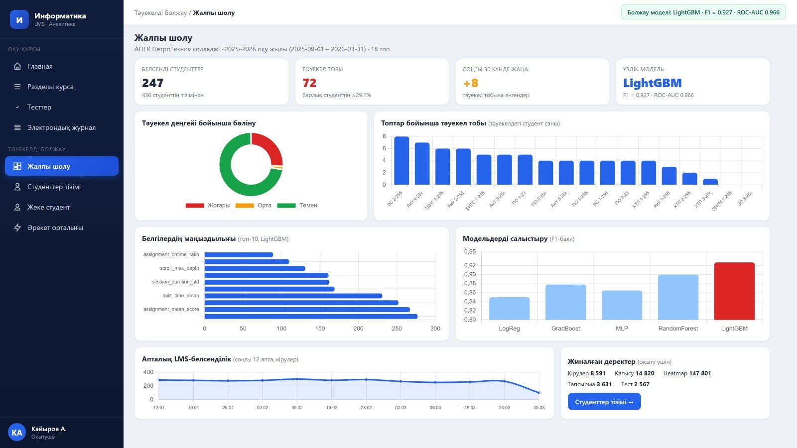
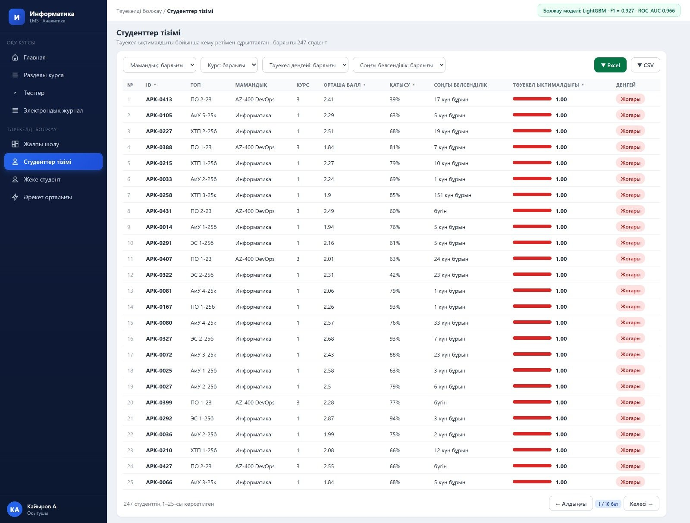
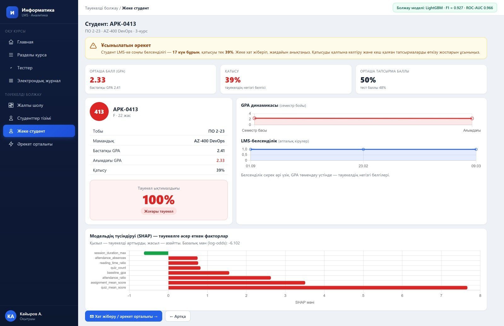
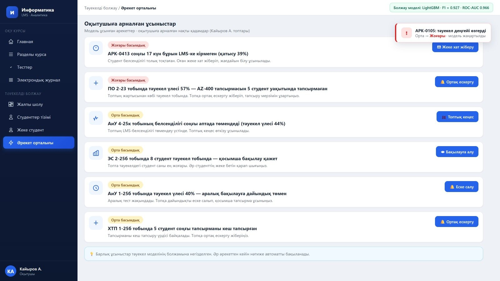

# Прогнозирование академического риска студентов по данным LMS

Пайплайн машинного обучения, который по активности студентов в системе управления обучением (LMS:
clickstream, задания, тесты, посещаемость) определяет тех, кто находится в группе академического риска.
В проект входят генерация данных, обучение и сравнение моделей и микросервис на **FastAPI** с
объяснением прогноза по каждому студенту.

> Основан на магистерской диссертации автора «Использование методов машинного обучения для прогнозирования
> действий пользователя в мобильных приложениях» (Атырауский университет имени Х. Досмухамедова, 2026),
> применённой к активности студентов колледжа в LMS. 🇬🇧 [English version](README.md)

## ⚠️ О репозитории

- **Исходный код диссертации утерян.** Репозиторий — это новая реализация методики из диссертации
  (те же 22 признака, те же пять алгоритмов и гиперпараметры, та же схема API).
- Реальные данные LMS содержат персональные данные студентов и **не публикуются**. Проект работает на
  **синтетических данных** (`generate_dataset.py`) той же структуры: 247 студентов, 18 групп, ≈29% в зоне риска.
- Поэтому метрики ниже получены на синтетике и **не равны результатам диссертации**.
  Результаты диссертации на реальных данных: LightGBM F1 = 0,927, ROC-AUC = 0,966, Accuracy = 0,960.
- Скриншоты в `docs/screenshots/` — это дашборд на Vue.js из диссертации (идентификаторы студентов
  обезличены). Код дашборда в репозиторий не входит.

## Пайплайн

```
generate_dataset.py  ->  data/students.csv   (22 признака + метка at_risk)
train_model.py       ->  models/lightgbm_risk.joblib + reports/ (метрики, графики)
prediction_api.py    ->  REST API (FastAPI) с моделью LightGBM
```

**Признаки (22)** объединяют clickstream (входы, длительность сессий, доля времени на чтение, глубина
прокрутки, индикатор «колебаний»), структурные данные (баллы за задания и тесты, сдача вовремя, исходный GPA)
и посещаемость. Полный список с описанием — в [`features.py`](features.py).

**Модели** (гиперпараметры из диссертации, `random_state=42`, сбалансированные веса классов):
логистическая регрессия, Random Forest (500 деревьев), Gradient Boosting (300, lr 0,05), LightGBM
(300, lr 0,05, 31 лист) и MLP (128-64). Оценка: стратифицированное разбиение (172 / 75 студентов) и
5-кратная стратифицированная кросс-валидация на обучающей части. В продакшене используется LightGBM,
как и в диссертации.

## Результаты на синтетических данных

Тест: 75 студентов (22 в зоне риска), один запуск с seed по умолчанию:

| Модель | F1 | ROC-AUC | Accuracy | Precision | Recall | CV F1 (5-fold) |
|---|---|---|---|---|---|---|
| Logistic Regression | 0,857 | 0,975 | 0,907 | 0,778 | 0,955 | 0,737 |
| Random Forest | 0,829 | 0,963 | 0,907 | 0,895 | 0,773 | 0,755 |
| Gradient Boosting | 0,619 | 0,916 | 0,787 | 0,650 | 0,591 | 0,654 |
| **LightGBM** | **0,864** | 0,964 | 0,920 | 0,864 | 0,864 | 0,704 |
| MLP | 0,773 | 0,955 | 0,867 | 0,773 | 0,773 | 0,785 |

При 75 тестовых студентах различия между моделями лежат в пределах шума, поэтому таблицу стоит
воспринимать как демонстрацию пайплайна, а не как бенчмарк.

## Быстрый старт

```bash
git clone https://github.com/<ваш-логин>/lms-student-risk-prediction.git
cd lms-student-risk-prediction
python -m venv .venv && source .venv/bin/activate      # Windows: .venv\Scripts\activate
pip install -r requirements.txt

python generate_dataset.py      # создаёт data/students.csv
python train_model.py           # обучает 5 моделей, сохраняет models/lightgbm_risk.joblib
uvicorn prediction_api:app --reload
pytest                          # по желанию: запуск тестов
```

Интерактивная документация API: <http://127.0.0.1:8000/docs>

## API

| Метод | Адрес | Описание |
|---|---|---|
| GET | `/health` | Проверка работоспособности |
| GET | `/model/info` | Модель, дата обучения, метрики, список признаков |
| POST | `/predict` | Риск по вектору признаков из тела запроса |
| POST | `/predict/{student_id}` | Риск студента из таблицы данных |
| POST | `/predict/batch` | Риск по списку `student_ids` или по всей группе `group` |
| GET | `/explain/{student_id}` | Вклад признаков (SHAP-значения LightGBM) |

Уровни риска: `low` < 0,33, `medium` < 0,66, иначе `high` («светофор» из дашборда).

## Скриншоты дашборда (из диссертации)

| Обзор | Список студентов |
|---|---|
|  |  |
| **Страница студента с SHAP** | **Центр действий преподавателя** |
|  |  |

## Ограничения

- Синтетические данные: результаты нельзя переносить на реальный колледж. В диссертации отмечено то же
  ограничение для реальной модели: она обучена на данных одного колледжа.
- В репозиторий не входят дашборд на Vue.js, интеграция с LMS, аутентификация, кэширование и
  инфраструктура развёртывания, описанные в диссертации.
- Реальные данные студентов нужно обрабатывать в соответствии с законом о защите персональных данных
  (обезличивать до анализа).

## Лицензия

MIT, см. [LICENSE](LICENSE).
